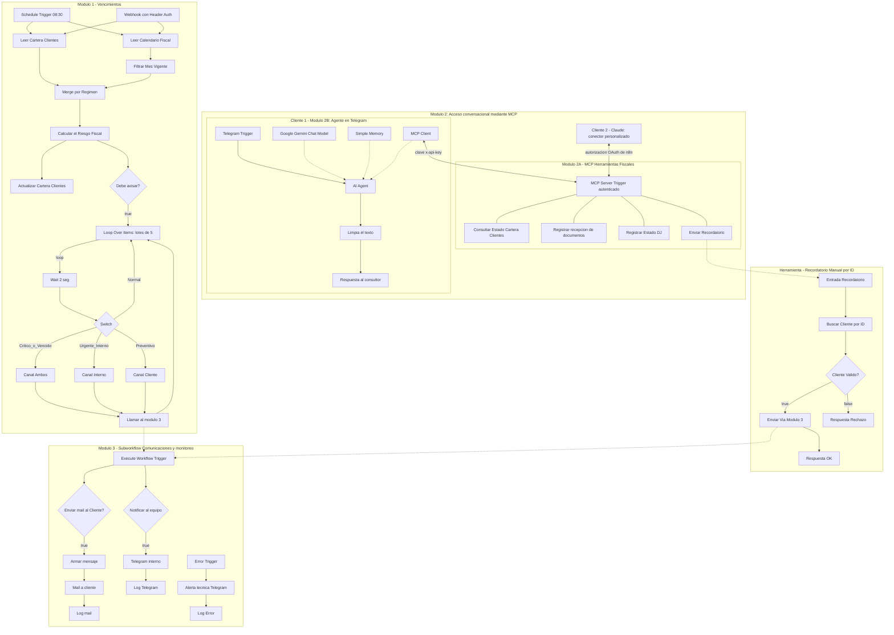

# Asistente Fiscal Automatizado para Estudio Contable

**Trabajo final · Automatización con n8n**

**Integrantes:** Guido Aldama, Alejandro _[Apellido]_
**Fecha de entrega:** 25/10/2026

---

## 1. El problema que elegimos resolver

En un estudio contable, una de las tareas más repetitivas es el seguimiento de los vencimientos fiscales. Cada mes alguien tiene que revisar el calendario de la DGI, cruzarlo con la cartera de clientes, verificar quién ya envió la documentación y quién no, y escribir los recordatorios uno por uno. Es un trabajo manual, propenso a olvidos, y un olvido puede traducirse en multas y recargos para el cliente.

Elegimos este caso porque conocemos el problema de primera mano desde la práctica profesional en el área de impuestos, y porque combina varias cosas que queríamos explorar en n8n: procesamiento de datos, reglas de negocio, comunicaciones automáticas y asistentes de IA que trabajen sobre datos reales.

## 2. Nuestra solución

Construimos un sistema que trabaja en dos frentes:

- **Un motor proactivo** que todos los días a las 08:30 (hora de Montevideo) revisa la cartera, calcula cuántos días faltan para cada vencimiento, clasifica el riesgo de cada cliente y envía los avisos que correspondan: un email al cliente cuando falta su documentación, y una alerta por Telegram al equipo cuando hay algo urgente que resolver.
- **Acceso conversacional a la cartera mediante MCP (Model Context Protocol).** Construimos un servidor MCP con cuatro herramientas para consultar la cartera, registrar la documentación recibida, actualizar el estado de la declaración jurada y enviar recordatorios. Cualquier asistente compatible con MCP puede usarlo. Lo conectamos a dos clientes:
  - un **agente propio en Telegram**, pensado para el día a día desde el celular ("¿qué clientes tienen la DJ vencida?");
  - **Claude**, como conector personalizado, más cómodo para análisis largos sobre la cartera.

Los dos clientes usan las mismas herramientas con las mismas restricciones de seguridad, porque esas restricciones están dentro del servidor y no en cada asistente.

Todas las acciones quedan registradas en un panel de auditoría, y cualquier falla técnica genera una alerta inmediata.

## 3. Arquitectura

Organizamos la solución en **cinco workflows**, cada uno con una responsabilidad clara:

| Workflow | Responsabilidad |
|---|---|
| `Modulo 1 - Vencimientos` | El motor proactivo: lee los datos, calcula el riesgo y decide a quién avisar |
| `Modulo 2A - MCP Herramientas Fiscales` | El servidor MCP: expone las herramientas que usan los clientes MCP (el agente de Telegram y Claude) |
| `Modulo 2B: Agente en Telegram` | Nuestro propio cliente MCP: un agente conversacional en Telegram |
| `Herramienta - Recordatorio Manual por ID` | Un intermediario de seguridad entre los clientes MCP y los envíos |
| `Módulo 3 - Subworkflow Comunicaciones y monitoreo` | Envía emails y alertas, registra todo y monitorea los errores |

Separar las comunicaciones en un sub-workflow propio (el Módulo 3) nos permitió reutilizar la misma lógica de envío y registro desde el motor automático y desde los recordatorios que piden los clientes MCP, sin duplicar nodos. Con la misma idea, separar el servidor MCP (2A) del agente de Telegram (2B) nos permitió sumar a Claude como segundo cliente sin tocar nada del lado de n8n.



## 4. Los datos

Usamos un Google Sheets (`BD_Estudio_Contable_n8n`) como base de datos, con tres pestañas:

- **`Cartera_Clientes`:** los datos de cada cliente (ID, razón social, RUT, régimen, contacto, consultor asignado, impuestos que liquida y estado de su documentación y de su declaración jurada). El `ID` es la clave única con la que todo el sistema identifica a cada cliente. La columna `Consultor` indica la persona del estudio asignada a ese cliente, que es además quien consulta y actualiza la cartera desde el agente de Telegram. Algunas columnas las completa el propio sistema: la fecha de vencimiento, los días restantes, el nivel de alerta, la acción sugerida y el registro del último aviso enviado.
- **`Calendario_Fiscal`:** una fecha de vencimiento por régimen y por mes. Puede contener el año completo, porque el sistema toma automáticamente las fechas del mes en curso. Los impuestos a liquidar no figuran acá sino en la cartera, porque dependen de cada cliente.
- **`Panel_Monitoreo_Logs`:** el registro de auditoría, con una fila por cada envío (email o Telegram) y por cada error, indicando su origen.

Elegimos Google Sheets por una razón práctica: una persona del estudio puede abrir la planilla, entender los datos y corregirlos sin conocimientos técnicos, y en la demo se ven los cambios en tiempo real. Somos conscientes de sus límites, que detallamos en la sección 10.

## 5. Cómo funciona el motor de vencimientos

El Módulo 1 se dispara todos los días a las 08:30, o a pedido mediante un webhook protegido con clave. Ambos disparadores ejecutan exactamente el mismo proceso. Lee la cartera y el calendario, se queda con las fechas del mes vigente y cruza a cada cliente con el vencimiento de su régimen. Si el calendario no tiene fechas cargadas para el mes en curso, el flujo se detiene y envía una alerta técnica, para que nunca pase un mes sin control sin que nadie lo note.

Luego, el nodo `Calcular el Riesgo Fiscal` aplica las reglas de negocio que definimos:

| Situación del cliente | Nivel | A quién se avisa |
|---|---|---|
| Ya presentó la DJ | COMPLETADO | A nadie |
| Venció y falta su documentación | VENCIDO | Al cliente y al equipo |
| Venció pero la documentación ya está en el estudio | URGENTE_INTERNO | Solo al equipo |
| Faltan 2 días o menos y falta su documentación | CRITICO | Al cliente y al equipo |
| Faltan 2 días o menos y la documentación ya llegó | URGENTE_INTERNO | Solo al equipo |
| Faltan 5 días o menos y falta su documentación | PREVENTIVO | Al cliente |
| Cualquier otro caso | NORMAL | A nadie |

El criterio detrás de esta tabla es simple: **al cliente solo le escribimos cuando necesitamos pedirle algo**. Si la documentación ya está en el estudio, cualquier atraso es responsabilidad interna, y no tiene sentido enviarle un mail pidiéndole algo que ya entregó.

En paralelo, el resultado del cálculo se guarda en la cartera, para que cualquier cliente MCP pueda consultar el estado de cada cliente sin recalcularlo.

Los clientes que deben recibir aviso se procesan en lotes de cinco, con una breve pausa entre lotes para no saturar los servicios de correo y mensajería, y un `Switch` define el canal según la gravedad: ambos canales para VENCIDO y CRITICO, solo Telegram para URGENTE_INTERNO y solo email para PREVENTIVO. La salida `Normal` del `Switch` funciona como red de seguridad: en la práctica no recibe clientes, porque el filtro anterior ya descarta a quienes no necesitan aviso.

### Evitar avisos repetidos

Una de las primeras cosas que notamos al probar el sistema fue que, sin control, un cliente pendiente recibiría el mismo mail todos los días. Para evitarlo, el sistema guarda en la cartera la fecha del último aviso y qué aviso fue (nivel y vencimiento). Con eso aplicamos estas reglas:

- El motor nunca envía más de un aviso por día al mismo cliente.
- Cada cliente recibe un aviso por nivel y por vencimiento. Si su nivel cambia, se le vuelve a avisar: por ejemplo, de PREVENTIVO a CRITICO, o de CRITICO a URGENTE_INTERNO cuando llega la documentación y el equipo tiene que tomar la posta.
- Si la DJ vence con la documentación ya en el estudio, el equipo recibe una nueva alerta interna, aunque el nivel siga siendo URGENTE_INTERNO. Así el equipo se entera de que el plazo efectivamente se venció.
- Los clientes vencidos con documentación pendiente reciben un recordatorio cada tres días mientras la situación persista.
- Cada nuevo mes reinicia el control de avisos, porque cambia el vencimiento.

Los recordatorios manuales que piden los clientes MCP (sección 6) no pasan por este control: son una decisión explícita del consultor.

### Mensajes según la gravedad

El nodo `Armar mensaje` redacta un email distinto según el nivel del cliente: urgente para un vencido (mencionando el riesgo de multas y recargos), firme para un caso crítico y amable para un recordatorio preventivo. Para cualquier otro nivel usa un recordatorio general, que es el que recibe, por ejemplo, un cliente al que el consultor le envía un recordatorio manual antes de que entre en zona de alerta. Un recordatorio manual usa siempre el nivel actual del cliente: si está CRITICO, recibe el mail de CRITICO. Los plazos se expresan en lenguaje natural, como "vence mañana" o "venció hace 4 días".

## 6. Acceso conversacional mediante MCP

El motor avisa solo, pero el consultor también necesita preguntar y actuar sobre la cartera sin abrir la planilla. Para eso construimos un **servidor MCP** y lo conectamos a dos asistentes de IA.

### El servidor y sus herramientas

El `MCP Server Trigger` del Módulo 2A no responde a ningún pedido sin autenticación (devuelve `403`) y expone cuatro herramientas. Son las mismas para cualquier cliente que se conecte:

| Herramienta | Qué permite hacer |
|---|---|
| `Consultar Estado Cartera Clientes` | Leer la cartera completa (solo lectura) |
| `Registrar recepcion de documentos` | Cambiar el estado de la documentación de un cliente a Pendiente, Recibida o Validada |
| `Registrar Estado DJ` | Cambiar el estado de la declaración jurada a No presentada, En borrador o Presentada |
| `Enviar Recordatorio` | Enviar un recordatorio por email a un cliente, indicando solo su ID |

### Dos clientes, un mismo servidor

**Cliente 1: nuestro agente en Telegram (Módulo 2B).** Es un agente que construimos en n8n con Gemini, memoria de las últimas interacciones de cada chat y un conjunto de reglas propias:

- consultar siempre la cartera antes de actuar;
- no inventar datos, y preguntar si falta un dato o hay más de un cliente que coincide;
- advertir cuando los días restantes no coinciden con la fecha de vencimiento, porque los datos pueden ser de la corrida anterior;
- pedir confirmación explícita antes de enviar un recordatorio;
- confirmar una acción solo cuando la herramienta devuelve un resultado exitoso, e informar exactamente qué hizo y sobre qué cliente;
- responder en lenguaje natural, sin los códigos internos del sistema.

Solo responde al chat autorizado.

**Cliente 2: Claude.** Agregamos el servidor como **conector personalizado** en Claude, con la _Production URL_ del `MCP Server Trigger`. Claude no usa la clave del agente de Telegram: se conecta mediante la **autorización OAuth de n8n**. Al agregar el conector, n8n abre una página donde el dueño de la instancia inicia sesión, aprueba el acceso de Claude y elige qué permisos darle. Le dimos solo los dos imprescindibles, leer y ejecutar workflows, y el acceso se puede revocar en cualquier momento desde n8n. Hay que distinguir dos niveles. Esos permisos limitan lo que Claude puede hacer sobre la instancia de n8n: no puede crear ni modificar workflows, ni ver credenciales. Lo que puede hacer sobre la cartera, en cambio, lo definen las herramientas. Por eso Claude sí puede cambiar el estado de la documentación y de la DJ y enviar recordatorios, exactamente como el agente de Telegram, pero nada más. Desde un chat de Claude se pueden hacer exactamente las mismas operaciones: consultar la cartera, registrar documentación, cambiar el estado de una DJ y enviar recordatorios. No tuvimos que modificar nada del lado de n8n.

Cada cliente tiene su lugar:

| | Agente de Telegram | Claude |
|---|---|---|
| Las cuatro herramientas | Sí | Sí |
| Restricciones de seguridad del servidor | Sí | Sí |
| Confirmación antes de enviar | Exigida por las reglas del agente | Depende del comportamiento de Claude, no la controlamos |
| Respuestas sin códigos internos | Por regla del agente | No garantizado |
| Cómo se autentica ante el servidor | Clave `x-api-key` | Autorización OAuth de n8n, con permisos elegidos |
| Quién puede usarlo | Solo el chat autorizado | Solo quien apruebe el acceso con la cuenta de n8n |
| Mejor para | Consultas y acciones rápidas desde el celular | Análisis más largos: resumir la cartera, comparar clientes, preparar un mensaje a partir de los datos |

De esta experiencia sacamos cuatro conclusiones:

- **Las herramientas son reutilizables.** Un mismo servidor atiende a dos asistentes distintos (Gemini en Telegram y Claude) sin duplicar lógica.
- **Las restricciones tienen que vivir en las herramientas, no en el prompt.** Que el envío reciba solo un ID o que la escritura se limite a dos columnas está resuelto en el servidor y en el workflow intermediario, por lo que protege a cualquier cliente. En cambio, las reglas de conversación de nuestro agente (pedir confirmación, no mostrar códigos internos) solo valen para ese agente, y dependen de que el modelo las respete.
- **Los datos calculados pueden quedar desactualizados.** Durante una prueba, Claude detectó clientes con 0 días restantes y un vencimiento ya pasado, y advirtió que los datos podían no estar al día. Es consecuencia de guardar el estado calculado en la cartera: refleja la última corrida del motor (ver sección 10).
- **Un mismo servidor admite formas de acceso distintas.** El agente de Telegram se autentica con una clave compartida; Claude, con la autorización de n8n, que exige iniciar sesión, permite elegir permisos y se puede revocar. La segunda es más segura, y es la dirección en la que querríamos llevar todos los accesos (ver sección 10).

### Decisiones de seguridad

Darle a una IA la capacidad de escribir en la base de datos y enviar correos implica riesgos. Las decisiones que tomamos se dividen en dos grupos.

**Resueltas en el servidor, válidas para cualquier cliente MCP:**

- **Escritura mínima.** Cada herramienta de actualización escribe una sola columna: el estado de la documentación o el de la declaración jurada. Los datos de contacto, el régimen y los valores calculados quedan fuera del alcance de cualquier cliente. Los valores permitidos se indican en la descripción de cada herramienta, pero todavía no se validan en el servidor (ver sección 10).
- **Actualizaciones por ID.** Al principio identificábamos al cliente por su razón social, pero un espacio invisible en la planilla bastaba para que la búsqueda fallara. Pasamos a usar el ID, que es único y no depende de cómo esté escrito un nombre.
- **Ningún cliente elige el destinatario.** La herramienta de envío solo recibe el ID del cliente. Un workflow intermedio busca el correo real en la cartera y valida tres cosas: que el cliente exista, que su declaración no esté presentada y que su documentación esté pendiente. Recién entonces envía; si no, devuelve un rechazo que el cliente MCP le informa al consultor. Así, el criterio de escribirle al cliente solo cuando necesitamos algo también se cumple en los envíos manuales. Aunque alguien pida mandar el recordatorio a otra dirección, ni el agente de Telegram ni Claude pueden hacerlo.
- **Acceso protegido.** El servidor MCP y el webhook del motor rechazan cualquier pedido sin autenticación. El webhook y el agente de Telegram usan una clave (Header Auth); Claude usa la autorización OAuth de n8n, con permisos para leer y ejecutar workflows pero no para modificarlos. Ninguna clave está escrita en los nodos: todas se gestionan como credenciales de n8n.

**Propias del agente de Telegram:**

- **Confirmación humana.** Antes de enviar cualquier recordatorio, el agente muestra el cliente, su correo, su nivel de alerta y sus días restantes, y espera que el consultor confirme.
- **Chat restringido.** La restricción está configurada en el propio `Telegram Trigger`: los mensajes de cualquier chat distinto del autorizado se ignoran antes de llegar al agente.

## 7. Monitoreo y manejo de errores

El Módulo 3 cumple también el rol de **Error Workflow** de los otros cuatro workflows, configurado en los ajustes de cada uno. Si cualquiera falla, un `Error Trigger` envía una alerta técnica por Telegram indicando el workflow, el nodo y el mensaje del error, y la registra en el panel de monitoreo con el nombre del workflow que falló. No hace falta activar el Módulo 3 para esto: alcanza con seleccionarlo como Error Workflow.

Cada envío queda registrado con su canal y su origen, sea un aviso del motor o un recordatorio manual pedido desde un cliente MCP. Un aviso que va por ambos canales genera dos filas, una por el email y otra por el Telegram. Esto nos da trazabilidad completa de lo que hizo el sistema.

Sobre la retención de datos: como las ejecuciones contienen información fiscal de clientes, en un entorno self-hosted configuraríamos `EXECUTIONS_DATA_PRUNE=true` y `EXECUTIONS_DATA_MAX_AGE=168` para conservarlas solo siete días. En n8n Cloud, la retención depende del plan contratado.

## 8. Requisitos de la consigna

| Requisito | Cómo lo cubrimos |
|---|---|
| Nodos avanzados | `Merge`, `Debe avisar?` (IF), `Loop Over Items` (SplitInBatches), `Wait` y `Switch` en el Módulo 1 |
| Transformación de datos | Cuatro Code Nodes: filtro del mes vigente, cálculo de riesgo, armado de mensajes y saneado de texto |
| Sub-workflow reutilizable | El Módulo 3, utilizado por el motor y por la herramienta de recordatorio |
| MCP Server y Client | Servidor con cuatro herramientas y autenticación por header, consumido por dos clientes: nuestro agente de Telegram (MCP Client de n8n) y Claude (conector personalizado) |
| Agente de IA | Agente conversacional propio en Telegram con memoria y reglas de negocio, y Claude como segundo asistente sobre las mismas herramientas |
| Manejo de errores | Error Workflow configurado en los cuatro workflows, con alerta técnica y registro |
| Panel de monitoreo | `Panel_Monitoreo_Logs`, con el origen de cada envío y de cada error |
| Seguridad | Credenciales gestionadas en n8n, clave para el webhook y el agente de Telegram, autorización OAuth con permisos mínimos para Claude, restricciones en las herramientas válidas para cualquier cliente y acceso restringido en Telegram |

## 9. Desafíos y aprendizajes

El camino no fue lineal, y varios de los problemas que encontramos terminaron mejorando el diseño:

- **Formato de fechas.** La planilla devolvía las fechas como `19/10/2026`, que JavaScript interpreta como mes/día. Tuvimos que escribir nuestra propia función para leerlas, y fijamos la zona horaria del workflow en Montevideo para que tanto la hora de ejecución como el cálculo de los días correspondan a Uruguay.
- **Datos que se borraban solos.** Un nodo de actualización mal configurado sobrescribía con vacío las columnas que no tenían valor asignado. Aprendimos a mapear con cuidado cada columna que escribe un nodo.
- **Adaptación al contexto uruguayo.** En Uruguay el vencimiento depende del grupo de contribuyente, así que simplificamos el cruce para que dependa solo del régimen. También pasamos los impuestos a liquidar a nivel de cada cliente, porque dos empresas del mismo régimen pueden liquidar impuestos distintos.
- **Una alerta que nunca llegaba.** Al revisar el control de avisos repetidos encontramos un caso que no se avisaba: si un cliente entregaba la documentación y la DJ igual se vencía, su nivel seguía siendo URGENTE_INTERNO y el sistema lo consideraba un aviso ya enviado. Lo corregimos para que el vencimiento efectivo genere una alerta interna nueva.
- **El agente decía haber hecho cosas que no hizo.** En una prueba, el agente de Telegram confirmó una actualización que en realidad había fallado. Ajustamos sus reglas para que solo confirme acciones cuando la herramienta devuelve un resultado exitoso.
- **Formato de mensajes en Telegram.** Las respuestas del modelo incluían caracteres que Telegram interpretaba como formato y rechazaba. Lo resolvimos con un nodo que limpia el texto antes de enviarlo. Más adelante encontramos el mismo problema en las alertas del Módulo 3: si no se indica un formato, n8n envía los mensajes como Markdown, y un guion bajo (en un nivel como URGENTE_INTERNO o en un error que menciona Calendario_Fiscal) hacía que Telegram los rechazara. Pasamos esas alertas a HTML y escapamos los datos variables.
- **Un servidor, varios clientes.** Al conectar Claude comprobamos que la seguridad conviene resolverla en las herramientas y no en el prompt de un agente concreto, porque el prompt solo gobierna a ese agente.
- **Cómo se autentica Claude.** Al principio intentamos cargar la clave del servidor en los campos de OAuth del conector de Claude, y obtuvimos un error `invalid_client`. Investigando descubrimos que los conectores de Claude no envían una clave fija: se autorizan con un inicio de sesión. Al agregar el conector sin completar esos campos, n8n ofreció su propia autorización OAuth, con elección de permisos. Así Claude quedó conectado con acceso mínimo, y cuando cambiamos la clave del agente de Telegram, Claude no se vio afectado.

## 10. Limitaciones y próximos pasos

Somos conscientes de que esta es una primera versión. Las principales limitaciones son:

- **Datos de la última corrida.** Los días restantes y el nivel de alerta se recalculan solo cuando corre el motor, por lo que cualquier cliente MCP consulta los datos de la última corrida. Lo vimos en una prueba: pasada la fecha de vencimiento y antes de la corrida de las 08:30, Claude señaló que los datos estaban desactualizados.
- **Los estados no se reinician solos al cambiar de mes.** El estado de la documentación y el de la DJ son una sola columna por cliente, sin período. Al empezar un nuevo período hay que volverlos a Pendiente y No presentada, desde la planilla o con el agente. Si no, un cliente que presentó en octubre figuraría como COMPLETADO en noviembre.
- **Los vencidos del mes anterior dejan de seguirse.** El motor solo mira el vencimiento del mes en curso, así que una DJ que quedó vencida al cerrar el mes deja de generar alertas cuando empieza el siguiente.
- **Clientes fuera del cruce.** Si el régimen de un cliente no tiene fecha en el calendario del mes, o está escrito distinto, el cliente queda fuera del cruce sin aviso: no se actualiza ni recibe alertas.
- **Valores no validados en el servidor.** Las herramientas de actualización solo pueden escribir su columna, pero no controlan qué valor escriben: la lista de valores permitidos está en la descripción que lee el modelo. Si un cliente MCP escribiera, por ejemplo, "Entregado", el motor trataría esa documentación como recibida y dejaría de avisarle al cliente.
- **Confirmación solo en Telegram.** La confirmación previa al envío depende de las reglas de nuestro agente. Desde Claude depende de su propio comportamiento.
- **Fallas de envío.** El aviso se registra como enviado antes de que el envío ocurra. Si un envío falla, la corrida se detiene, se alerta el error, y los clientes que quedaban por procesar ese día no reciben su aviso; como ya quedaron registrados como avisados, hay que forzar el reenvío manualmente.
- **Recordatorios manuales fuera del control de repetidos.** No actualizan el registro del último aviso, por lo que pueden coincidir con un aviso automático el mismo día.
- **Un único chat interno.** Todas las alertas internas llegan a un único chat, y no a cada consultor.
- **Clave compartida.** El servidor MCP es accesible desde internet. Claude accede con una autorización individual y permisos limitados, pero el agente de Telegram y el webhook usan una clave compartida, sin permisos diferenciados por usuario.
- **Integridad de los datos.** Google Sheets no garantiza la integridad de los datos: no tiene restricciones de valores, transacciones ni control de acceso por usuario.

Para una versión en producción, nuestros próximos pasos serían:

- Migrar los datos a una base relacional como **Supabase / PostgreSQL**, con claves primarias, valores restringidos y transacciones.
- Guardar los estados por período, o reiniciarlos automáticamente cuando cambia el vencimiento, y mantener el seguimiento de las DJ vencidas de meses anteriores.
- Validar en el servidor los valores que escriben las herramientas, con un workflow intermedio como el que ya usamos para los recordatorios.
- Advertir cuando un cliente no tiene vencimiento en el calendario del mes.
- Incluir en la respuesta de consulta la fecha de la última actualización, para que cualquier cliente pueda advertir si los datos están viejos.
- Llevar la confirmación de envío al servidor (por ejemplo, un paso de aprobación), para que no dependa del cliente.
- Que una falla de envío no detenga la corrida, y registrar los envíos fallidos por cliente para reintentarlos de forma selectiva.
- Extender a los demás accesos la autorización con OAuth y permisos por usuario que ya usa Claude, en lugar de una clave compartida.
- Asignar las alertas internas a cada consultor y permitir que todo el equipo use el bot.
- Agregar herramientas de consulta filtrada al servidor MCP, para escalar con carteras grandes.
- Incorporar un modo de prueba que redirija todos los envíos a una casilla interna.

## 11. Cómo probar el proyecto

**Requisitos:** credenciales de Google Sheets, Gmail, Telegram, Google Gemini y una credencial Header Auth (`x-api-key`) configuradas en n8n.

**Disparo manual del motor:**

```
curl.exe -X POST "https://<instancia>.app.n8n.cloud/webhook/control-vencimientos" -H "x-api-key: <clave>"
```

Sin la clave, el webhook responde `403 Forbidden`.

**Conectar Claude al servidor MCP:**

1. Con el workflow `Modulo 2A - MCP Herramientas Fiscales` activo, copiar la _Production URL_ del `MCP Server Trigger`.
2. En Claude, ir a **Customize → Connectors → Add custom connector**, ponerle un nombre y pegar esa URL.
3. Claude intenta verificar el servidor y recibe un `403`, porque no tiene la clave: es lo esperado. Elegir **Continue anyway** y conectar sin completar los campos de Client ID ni Client Secret.
4. Se abre una página de la instancia de n8n que pide autorizar a Claude. Elegir **Custom**, dejar marcados solo `workflow:read` y `workflow:execute`, y hacer clic en **Allow access**.
5. Verificar en la lista del conector que aparezcan las cuatro herramientas, y activarlo en un chat nuevo.

El acceso de Claude se puede revocar en cualquier momento desde la configuración de n8n.

**Ejemplos de consultas, válidos tanto en Telegram como en Claude:**

- "¿Qué clientes tienen la DJ vencida?"
- "Distribuidora del Sur SA entregó la documentación, marcala como recibida"
- "Importadora Río Plata pasó a borrador"
- "Mandale un recordatorio a Tech Soluciones SAS" (en Telegram, el agente pide confirmación antes de enviar)
- "Mandale el recordatorio a otro@gmail.com" (en ambos casos el envío va al correo registrado en la cartera)
- "Mandale un recordatorio a un cliente que ya entregó la documentación" (el envío se rechaza y el asistente informa el motivo)

**Ejemplos que aprovechan Claude para análisis:**

- "Resumí el estado de la cartera por régimen y decime qué clientes necesitan atención esta semana"
- "¿Qué consultor tiene más clientes con documentación pendiente?"

Si la consulta se hace antes de la corrida diaria, los días restantes y los niveles de alerta pueden reflejar la corrida anterior; para ver datos al día se puede disparar el motor con el webhook.

**Probar la alerta técnica:** el Error Workflow solo se dispara en ejecuciones automáticas (webhook, schedule, mensajes de Telegram o llamadas MCP), no al ejecutar un workflow desde el editor. Para verla en la demo, conviene provocar el error disparando el motor con el webhook; por ejemplo, con un mes sin fechas en el calendario.

_Nota: los datos de clientes y algunas fechas del calendario son de prueba, y todos los correos llegan a una casilla del equipo._
